<div align="center">




<a href="https://git.io/typing-svg"></a>

<br/>

<a href="https://t.me/od1nson"></a>


</div>

<br/>

```kotlin
object Od1ns0n : Engineer {
    override val role      = "Full-stack • Real-time • Android internals • Reverse engineering"
    override val fluent    = listOf("Kotlin", "Java", "Python", "TypeScript", "JavaScript", "C++", "C", "Lua")
    override val reading   = listOf("Rust", "Go", "C#", "SQL/PLpgSQL", "Bash/PowerShell")
    override val backend   = listOf("FastAPI", "Spring Boot", "Node.js", "Next.js", "WebSocket", "TCP", "Prisma", "PostgreSQL")
    override val frontend  = listOf("React 19", "MUI/Joy", "Vite", "Tailwind")
    override val realtime  = listOf("LiveKit", "Daily.co", "WebRTC", "Socket.io", "Opus codec")
    override val mobile    = listOf("Android", "Jetpack Compose", "embedded VPN", "low-level services", "OkHttp/Retrofit")
    override val lowlevel  = listOf("Qt6 internals", "WinAPI", "DLL injection", "reverse engineering", "ProGuard/R8")
    override val infra     = listOf("Docker", "Nginx", "Linux", "CI/CD", "Google Cloud", "Firebase FCM")

    override fun build() = pipeline(mobile, server, frontend, deploy).withUptime(SLA)
}
```

<div align="center">

## ⚡ ARSENAL


<br/>

<br/>


<br/>


</div>

<br/>

<div align="center">

## 🛰 SELECTED WORK

</div>

> **🔐 Corporate messenger — full platform** &nbsp;·&nbsp; `web + android`
> Собственный мессенджер уровня Telegram: 1-на-1 и групповые чаты, вложения, голосовые с
> транскрипцией, аудио/видео-звонки и демонстрация экрана на **LiveKit + Daily.co**, push через Firebase.
> **Web:** Next.js 16 · React 19 · TypeScript · Prisma 7 · PostgreSQL · Socket.io · Google Cloud Storage · argon2 + JWT.
> **Android:** Kotlin · Jetpack Compose · нативные call-клиенты · **встроенный VPN** с failover по пулу
> серверов и masked-TLS для обхода блокировок · encrypted prefs · foreground-сервисы звонков.

> **🖥 Desktop app reverse engineering & modding** &nbsp;·&nbsp; `c++ / qt6 / winapi`
> Реверс и модификация десктопного **Qt6**-клиента: мультиаккаунт с полной изоляцией профилей,
> персистентные сессии, вырезание телеметрии. Низкоуровневая работа с процессами и WinAPI.

> **🤖 Remote Android control suite** &nbsp;·&nbsp; `react + python + android` &nbsp;·&nbsp; `private`
> Сложная связка React-фронт ↔ Python-бэк ↔ Android: удалённое управление устройством и доступ
> к его подсистемам в реальном времени. 15+ взаимосвязанных компонентов. Детали под NDA.

> **📦 Kamazomovi** &nbsp;·&nbsp; `releases + auto-update`
> Публичные релизы и инфраструктура автообновления (приватные исходники).

> **🧰 Also shipped**
> Кастомизация и мод клиента Telegram · корпоративный файлообменник · полнофункциональный
> генератор документов (Spring Boot) · видеоредактор со встроенной записью экрана ·
> self-made виджеты мониторинга состояния систем.

<br/>

<div align="center">

## 🧠 WHAT I BUILD

| 📱 Mobile | 🖥 Backend | 🌐 Frontend | 🚀 Infra |
|:---:|:---:|:---:|:---:|
| VPN-integrated Android apps | Async Python / FastAPI | React dashboards + live device control | Docker + Nginx + CI/CD |
| Compose UI, native call clients | Next.js / Spring Boot / Node.js | MUI / Joy UI / Tailwind | Linux deploy · Google Cloud |
| Low-level services, codecs | WebSocket / TCP real-time cores | Vite · real-time streaming | Firebase · release automation |

> End-to-end: от аудиокодека и bare-socket на Android до React-дашборда, который им управляет.

</div>

<br/>

<div align="center">

## 📡 TELEMETRY




</div>

<br/>

<div align="center">

## 📌 PINNED

<a href="https://github.com/0d1ns0n/kamazomovi-releases"></a>
<a href="https://github.com/0d1ns0n/StudyMavenUnit"></a>

</div>

<br/>

<div align="center">


</div>
